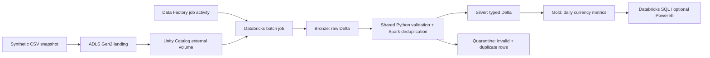

# Financial Transactions Lakehouse and Analyst Portfolio

A portfolio data engineering project using **Azure Databricks, PySpark, Delta
Lake, Unity Catalog, ADLS Gen2, Azure Data Factory, and SQL**. Includes a
dependency-free Python reference pipeline so you can run a demo without Azure.
All generated transactions are synthetic; no customer or banking data is used.

## Data analyst project: Finance Analyst Studio

Analyze transaction activity, posted cash flow, decline rates, and merchant-country
concentration using Python, SQL, and Power BI Desktop or a local Streamlit dashboard.
The existing pipeline remains dependency-free; the dashboard is an optional extra.

```powershell
python -m pip install -e ".[dashboard]"
python -m finance_lakehouse generate
python -m finance_lakehouse run
python -m streamlit run dashboard.py
```

Open the localhost URL printed by Streamlit. The dashboard reads the existing
`data/output/silver_transactions.jsonl`; it never generates or replaces input
data. The `generate` and `run` commands above replace the demo files as described
below; skip them if your existing local output is already ready.

### Power BI Desktop report

Open [Finance Analyst Studio.pbip](powerbi/Finance%20Analyst%20Studio.pbip) in
Power BI Desktop. Keep its sibling Report and SemanticModel directories together.
Click **Home > Refresh** to import the existing Silver snapshot, then save.
The report contains two pages:

- **Financial overview:** posted inflow, outflow, net cash flow, decline rate,
  daily cash-flow trends, and merchant-country gross activity.
- **Transaction analysis:** valid/posted/declined counts, active accounts, and
  transaction-level details including high-value flags.

Each page has its own currency and UTC date slicers. USD is selected initially.
Monetary measures return blank when more than one currency is in scope; no FX
conversion or cross-currency monetary totals are performed. Amounts use Power BI
fixed-decimal storage and count/decline metrics include declined attempts.
The report uses synthetic data and does not connect to a cloud workspace.
Use **File > Save as** in Desktop if you also want a single-file `.pbix` report.
If offered a TMDL upgrade when saving, choose **Don't upgrade** to retain the
generated TMSL semantic-model format.

To generate a fresh editable report from another validated local Silver snapshot:

```powershell
python -m tools.export_powerbi --input data\output\silver_transactions.jsonl --output powerbi-new
```

The exporter requires nonempty, valid, deduplicated transactions and refuses
existing output directories so it cannot overwrite report edits. Individual
amounts must fit Power BI fixed-decimal storage (maximum
922,337,203,685,477.5807); aggregate totals must also fit that type.
The semantic model stores an absolute input path. If you move the source file,
update the `File.Contents` path in **Transform data > Advanced Editor** before
refreshing, or export to a new directory using the new input path. After changing
the source data, rerun the pipeline and refresh the report; a saved import is
otherwise only a snapshot.

### Analyst workflow

1. Select one currency and an inclusive UTC date range.
2. Compare posted credit inflow, posted debit outflow, and net cash flow.
3. Investigate declines: declined attempts / all valid, deduplicated attempts.
4. Compare daily trends and posted gross activity by merchant country.
5. Inspect posted USD transactions >= 10,000 and export the filtered transactions.
6. Run [the SQL analyses](sql/analytics.sql) in Databricks SQL for country shares
   and window-function analysis of cash-flow changes.

### Large Kaggle project: PaySim fraud analytics

The separate [PaySim Power BI project](powerbi-paysim/PaySim%20Fraud%20Analytics.pbip)
uses the **full original PaySim v2 dataset**, not the 1,000-row demo above.
Open it in Power BI Desktop, click **Home > Refresh**, then save. Keep its Report
and SemanticModel directories together. The existing finance report is unchanged.

The three report pages cover:

1. **Transaction overview:** volume, transaction amounts, fraud labels, hourly
   trends, and transaction types.
2. **Fraud labels and rule performance:** simulator labels versus the supplied
   `isFlaggedFraud` rule; precision, recall, confusion counts, and all labelled cases.
3. **Top originators - snapshot:** top 1,000 originators ranked by transaction
   count, then amount, then ID. This is a whole-snapshot cohort, not all accounts;
   this page has no hour/type slicers. Distinct originator/recipient KPIs on this
   page describe the full source snapshot, not just the cohort.

Power BI imports a compact star schema: hourly/type/label aggregates, shared hour
and type dimensions, all fraud-labelled rows, and the account cohort. Overview and
fraud-page slicers are independent, and each filters both aggregate metrics and
fraud details through one-directional dimension relationships. The full
transaction-level Parquet remains available locally for deeper SQL analysis but
is deliberately **not imported** into the default report.

Verified original-v2 snapshot (independently reconciled against the ZIP CSV with
Python `Decimal`):

| Metric | Value |
| --- | ---: |
| Source transactions | 6,362,620 |
| Transaction amount, unspecified local units | 1,144,392,944,759.77 |
| Fraud-labelled transactions | 8,213 |
| Fraud-labelled amount, not realized loss | 12,056,415,427.84 |
| Fraud label rate | 0.129082% |
| Supplied rule flags / true positives / false positives | 16 / 16 / 0 |
| Supplied rule false negatives | 8,197 |
| Supplied rule precision / recall | 100% / 0.194813% |
| Observed simulation steps | 1-743 |

The supplied rule's 100% precision does **not** make it an effective detector:
it misses over 99% of simulator-labelled fraud. This is a useful portfolio
finding about rare-event analysis, not a claim about a real banking system.
Only 13,544 rows across the five compact model tables need to be imported;
all 6,362,620 raw rows remain in the full Parquet file.

#### Reproduce the full preparation

```powershell
python -m pip install -e ".[paysim]"
New-Item -ItemType Directory -Force data\external\paysim
curl.exe -L --fail --output data\external\paysim\paysim-v2.zip "https://www.kaggle.com/api/v1/datasets/download/ealaxi/paysim1?datasetVersionNumber=2"
python -m finance_lakehouse.paysim --input data\external\paysim\paysim-v2.zip --output data\paysim
python -m tools.export_paysim_powerbi --data data\paysim --output powerbi-paysim-new
python -m unittest discover -s tests -v
```

Skip the download/preparation if those local files already exist. Preparation and
report export refuse existing output directories; use new output names to retain
edits. Preparation accepts the original CSV or a ZIP containing exactly one CSV.
It validates every row, preserves zero amounts and repeated source rows, rejects
malformed values rather than rounding/dropping them, uses exact decimal money,
normalizes source scientific notation exactly (without accepting fractional
cents), and reconciles aggregate counts and amounts against the full input.
DuckDB uses a 512 MB working-memory limit, two threads, and disk spilling;
this is not a cap on total Python/OS memory. Allow several GB of temporary disk.
Prepared data is published only after validation and reconciliation succeed.

| Output in `data/paysim/` | Purpose |
| --- | --- |
| `transactions.parquet` | All original rows, renamed fields, exact decimals, source-row surrogate |
| `activity_summary.parquet` | Counts and amounts by hour, type, fraud label, and supplied flag |
| `simulation_hours.parquet`, `transaction_types.parquet` | Unique star-schema dimensions |
| `fraud_details.parquet` | Every fraud-labelled row, not a sample |
| `account_profiles.parquet` | Explicit top-1,000 originator cohort |
| `validation.json` | SHA-256 provenance, exact totals, per-type totals, row counts, and semantics |

The model stores absolute paths to prepared Parquet files. If moving the project,
regenerate to a new report directory using `--data <new-folder>`, or update each
`File.Contents` path in Power Query. Refresh after changing prepared data.
Snapshot distinct-account measures are generated from the manifest, so regenerate
the report as well when replacing the underlying snapshot. Save as `.pbix` in
Desktop if a single-file report is needed. Retain TMSL with **Don't upgrade** if
Desktop offers a TMDL conversion.

#### Interpretation and attribution

- One `step` is one **simulation hour**, not a real date or UTC timestamp.
  Derived day/hour use `(step-1)//24+1` and `(step-1)%24`; no calendar is invented.
- Amounts are in **unspecified local currency**, not USD/INR. Amount sums represent
  transaction activity, not revenue, net cash flow, or realized fraud losses.
- `isFraud` is simulator ground truth; `isFlaggedFraud` is a distinct supplied
  business rule, **not a model trained by this project**. Precision is TP/(TP+FP);
  recall is TP/(TP+FN). Undefined ratios remain blank.
- Source documentation warns against using post-transaction balances as fraud
  predictors. Balances are preserved in full Parquet but excluded from report
  predictors; this project performs descriptive analysis, not prediction.
- No source transaction ID is provided. `source_row_id` is a row-position
  surrogate, not a banking transaction identifier. No fabricated countries,
  currencies, approved/declined statuses, or demographic fields are added.
- Data source: Edgar Lopez-Rojas,
  [Synthetic Financial Datasets For Fraud Detection (PaySim), v2](https://www.kaggle.com/datasets/ealaxi/paysim1).
  Licensed [CC BY-SA 4.0](https://creativecommons.org/licenses/by-sa/4.0/).
  Renamed/typed Parquet and derived summaries retain this attribution and license;
  include the manifest and these notices if redistributing derived data.
- Reference: E. A. Lopez-Rojas, A. Elmir, and S. Axelsson,
  *PaySim: A financial mobile money simulator for fraud detection*, EMSS, 2016.

### KPI definitions and interpretation

| Metric | Definition |
| --- | --- |
| Net cash flow | Posted credits minus posted debits, in one currency |
| Average posted amount | Posted gross amount / posted transaction count |
| Active accounts | Distinct accounts across posted and declined attempts |
| Country posted amount | Posted credits + debits; gross activity, not revenue |
| Decline rate | Declined / all valid attempts; undefined when no attempts |

In Streamlit, amounts are calculated with Python `Decimal`. KPI money is displayed to two
decimal places; chart coordinates use approximate floats, while transaction
exports preserve decimal strings. Currency totals are never combined. Dates
without attempts are not filled with zeros. High-value flags apply only to USD
and are triage heuristics, not fraud predictions. Empty Silver snapshots and
missing/malformed input are reported in the UI rather than replaced with mock data.

### Portfolio questions and deliverables

- Which currency has the largest decline rate? Compare rates, not mixed-currency money.
- Which observed dates have negative posted net flow, and is debit activity the driver?
- What share of each currency's posted activity comes from each merchant country?
- How much source data was quarantined, and could excluding it bias the analysis?

Capture a filtered dashboard screenshot, a transaction CSV export, and a short
summary of findings supported by the SQL results. Clearly label findings as
synthetic: randomly generated patterns are not evidence of real customer behavior.
No predictive model, causal claim, FX conversion, or cloud-deployed Power BI report is
included. Ingestion quality counts remain whole-snapshot metrics in
`data/output/quality_report.json`, not filtered dashboard measures.

## Architecture



The local demo writes JSONL, **not Delta**. The Databricks job runs distributed
Spark and writes managed Unity Catalog Delta tables. Both use the same Python
validation function. The local Power BI report is an optional consumer;
no Power BI cloud resource is configured.

## Run locally (Windows PowerShell)

Requires Python 3.10+. No packages, Java, Azure login, or cloud charges needed.
Run from the project root:

```powershell
python -m finance_lakehouse generate
python -m finance_lakehouse run
python -m unittest discover -s tests -v
```

Default sample: 1,000 distinct valid transactions, six invalid rows and two
duplicates. Expected reconciliation:

```text
bronze_rows = 1008
silver_rows = 1000
quarantine_rows = 8
```

Outputs in `data/output/`:

| File | Meaning |
| --- | --- |
| `bronze_transactions.jsonl` | Input snapshot |
| `silver_transactions.jsonl` | Valid, deduplicated transactions |
| `quarantine_transactions.jsonl` | Original rejected rows and reasons |
| `gold_daily_metrics.jsonl` | Daily grouped metrics |
| `quality_report.json` | Counts and quarantine reasons |

Use `python -m finance_lakehouse generate --rows 5000 --seed 7` for a bigger
demo. Custom paths: `generate --output <csv>` and `run --input <csv> --output <folder>`.
The generator replaces the named CSV; the runner replaces its five named output
files. Use dedicated demo paths, not folders containing real financial data.

## Data contract and business rules

CSV header must appear in this exact order:

```text
transaction_id,account_id,event_time,amount,currency,transaction_type,merchant_country,status
```

- IDs: 1-64 ASCII letters, digits, hyphens or underscores; all fields required.
- Time: ISO 8601 with explicit timezone; normalize to UTC before deriving dates.
  Supported normalized years: 1900-2100.
- Amount: positive decimal, at most 16 integer and two fractional digits.
  No floats, rounding, exponential notation, negative values or zero amounts.
- Currency: USD, EUR, GBP or INR. No FX conversion or cross-currency totals.
- Type: DEBIT or CREDIT; status: POSTED or DECLINED.
- Country: two ASCII letters (format validation, not ISO registry validation).
- Latest **valid event timestamp** wins for each transaction ID. Equal timestamps
  use descending canonical lexical account/amount/currency/type/country/status
  values as deterministic tie-breakers. Exact duplicate winners are equivalent.
  This is a demo policy, not bank-grade source versioning.
- Invalid rows and losing duplicates are retained in quarantine with reason codes.
- `is_high_value`: USD amount >= 10,000, including declined attempts. This is a
  triage heuristic, **not fraud detection or compliance advice**.
- Gold groups by UTC date, currency, type and status, retaining declined attempts
  separately. Financial cash-flow queries must filter to POSTED.

## Azure setup and orchestration

Follow [the Azure setup guide](docs/azure-setup.md). Nothing is provisioned or
deployed automatically. It covers managed-identity storage access, running the
Databricks bundle and connecting the supplied Data Factory pipeline.

The notebook and Spark transformations also work in an AWS Databricks workspace
with a readable Unity Catalog volume. In that case, use AWS-compatible storage
or a managed volume instead of the Azure storage instructions. When importing
workspace files, preserve the sibling `notebooks/` and `finance_lakehouse/`
directories so the notebook can import its supporting Python modules.
If workspace ZIP import is unavailable, export a single self-contained notebook:

```powershell
python tools\export_notebook.py --output finance-lakehouse.ipynb
```

Import that file using Workspace > folder actions > Import. The exporter embeds
the current shared rules and Spark pipeline; regenerate after changing those
sources. Configure its catalog, dedicated schema and volume CSV path before
running. Importing the notebook does not upload data or execute compute.
Pass `--catalog`, `--schema`, and `--input-path` to the exporter to preconfigure
the notebook's widget defaults for an existing Unity Catalog volume.

Run [the analytics queries](sql/analytics.sql) in Databricks SQL after a successful
cloud run. Suggested dashboard: posted cash-flow by currency, daily transaction
volume, decline rate, high-value posted transactions, and quarantine reasons.

## Execution semantics and limitations

This project processes a **complete CSV snapshot**, not incremental CDC or a
stream. Every run replaces the project's four tables. Upload the complete input
before triggering the job; never change it during a run. Reprocessing the same
snapshot produces the same business results (Bronze ingestion timestamps change).
Do not pass a daily delta unless replacing all previous history is intended.

Use a dedicated schema. The job allows one concurrent run; avoid multiple bundle
deployments or external writers targeting the same schema. Table writes are
individually atomic Delta operations, **not one cross-table transaction**.
Consumers must wait for the full job to succeed. After a partial failure, rerun
the same snapshot before consuming results. Malformed CSV or empty input fails
the run; row-level business-rule errors go to quarantine. An all-invalid batch
intentionally produces empty Silver/Gold and a fully quarantined snapshot.

This is a portfolio starter, not a production banking platform. Production work
would add immutable source batches, transaction version/CDC semantics, release
gating, quality thresholds, access reviews, monitoring/alerts, and integration
tests on actual Databricks compute. The local reference runner holds data in
memory; use Spark for large data. Python UDF validation favors shared correctness
over maximum Spark throughput.

## Project map

- `finance_lakehouse/rules.py`: shared validation.
- `finance_lakehouse/local.py`: local reference pipeline.
- `finance_lakehouse/spark_pipeline.py`: distributed Databricks pipeline.
- `notebooks/run_lakehouse.py`: parameterized job entry point.
- `databricks.yml`: deployable job bundle using existing compute.
- `adf/pipeline.json`: Data Factory orchestration template.
- `tests/test_pipeline.py`: quality, precision, deduplication and rerun tests.

Local tests do not prove cloud identity, networking, Delta writes or bundle
deployment. Complete the cloud smoke test in the setup guide before claiming
an Azure deployment works.
